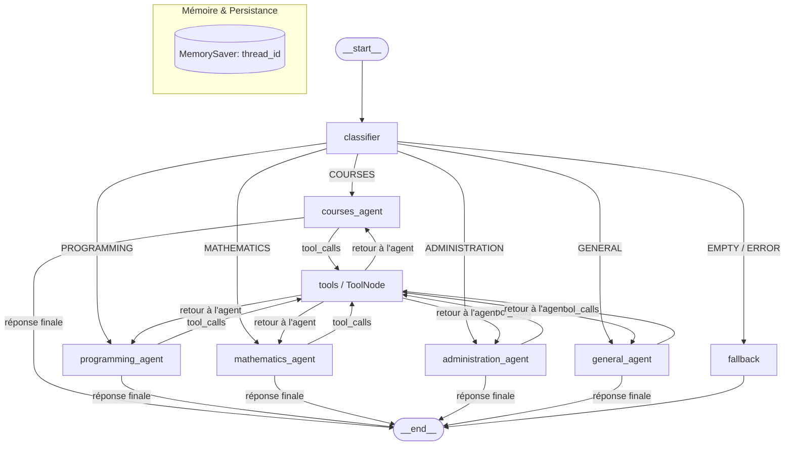

# Lab 3 — Building AI Agents with LangGraph

Ce projet constitue les travaux pratiques sur la conception d'agents conversationnels autonomes et modulaires à l'aide de **LangGraph**, **LangChain** et des modèles de langage (**LLMs**).

Il implémente un **Assistant Universitaire Intelligent (Capstone Project)** capable d'analyser l'intention d'un étudiant, d'orienter la requête vers un agent expert adapté, d'exécuter des outils en boucle fermée de manière sécurisée, et de conserver une mémoire conversationnelle persistant entre les tours de parole.

---

## 🏗️ Architecture du Système

Le graphe repose sur une architecture en étoile avec boucle d'outils réentrante et mémoire persistante :



---

## 🌟 Fonctionnalités Clés

1. **Classification Robuste des Intentions :**  
   Prise en charge de 5 domaines spécialisés (`COURSES`, `PROGRAMMING`, `MATHEMATICS`, `ADMINISTRATION`, `GENERAL`) avec gestion défensive des requêtes vides et des erreurs d'API.
2. **Exécution Sécurisée d'Outils (Sandboxed AST) :**  
   Remplacement de la fonction vulnérable `eval()` par un évaluateur arithmétique strict basé sur l'**AST Python** (`ast.parse`), interdisant toute injection de code arbitraire.
3. **Mémoire Conversationnelle Multi-Sessions :**  
   Gestion de l'historique par fil d'exécution (`thread_id`) via `MemorySaver`. Deux utilisateurs différents conservent des sessions totalement isolées.
4. **Récupération Automatique d'Erreurs :**  
   Interception des erreurs de syntaxe d'outils via `ToolNode(..., handle_tool_errors=True)` et reprise de dialogue sans interruption du graphe.

---

## 📁 Structure du Projet

```text
Lab3-langGraph/
├── langgraph_lab.ipynb         # Notebook complet exécuté avec sorties de cellules
├── langgraph_lab_Statement.ipynb# Copie conforme avec énoncé, solutions et sorties
├── REPORT.md                   # Rapport académique complet (questions conceptuelles, analyse critique)
├── README.md                   # Guide d'installation et d'utilisation du projet
├── architecture.mmd            # Diagramme Mermaid de l'architecture
├── requirements.txt            # Dépendances Python requises
├── main.py                     # Script d'exécution en ligne de commande et démonstration
├── screenshots/                # Captures d'écran de l'exécution
│   ├── 01_environment_setup.png
│   ├── 02_first_graph.png
│   ├── 03_two_stage_agent.png
│   ├── 04_conditional_routing.png
│   ├── 05_tools_and_memory.png
│   └── 06_capstone_assistant.png
└── src/                        # Code source modulaire
    ├── __init__.py             # Exports du package
    ├── state.py                # Définitions des états (TypedDict, add_messages)
    ├── tools.py                # Outils (@tool calculator AST, @tool current_datetime)
    ├── agents.py               # Prompts système, classifieur, factory d'agents, fallback
    └── graph.py                # Assemblage et compilation du StateGraph LangGraph
```

---

## 📸 Captures d'Écran d'Exécution

Toutes les étapes clés de l'exécution ont été capturées dans le dossier `screenshots/` :
* **`01_environment_setup.png`** : Installation et vérification des dépendances (`langgraph 1.2.19`, `langchain 1.4.8`).
* **`02_first_graph.png`** : Première exécution de `StateGraph` avec transfert d'état et exécution de nœud.
* **`03_two_stage_agent.png`** : Workflow multi-nœuds à deux étapes (`analyzer` $\rightarrow$ `generator`).
* **`04_conditional_routing.png`** : Routage conditionnel vers agents spécialisés et benchmark d'évaluation (100% de précision).
* **`05_tools_and_memory.png`** : Appel d'outils sécurisés AST et mémoire multi-tours persistante par `thread_id`.
* **`06_capstone_assistant.png`** : Démonstration complète du projet Capstone et inspection des traces d'outils.

---

## 🚀 Installation & Démarrage Rapide

### 1. Cloner ou naviguer dans le dossier du TP
```bash
cd Lab3-langGraph
```

### 2. Créer et activer un environnement virtuel
```bash
python3 -m venv .venv
source .venv/bin/activate
```

### 3. Installer les dépendances
```bash
pip install -r requirements.txt
```

### 4. Configurer la clé d'API (OpenAI)
Définissez votre clé d'API dans votre environnement :
```bash
export OPENAI_API_KEY="votre_cle_api"
```

---

## 💻 Exécution

### Option A — Lancer la démonstration complète via le terminal
```bash
python main.py
```
Le script exécute une batterie de tests démontrant :
- L'orientation vers chaque agent spécialisé.
- L'appel automatique de la calculatrice pour une question mathématique.
- L'appel de l'outil d'horodatage pour une question sur la date courante.
- L'interception propre d'une requête vide par le nœud de secours.
- La persistance de la mémoire sur plusieurs tours au sein d'un même `thread_id`.

### Option B — Lancer le Notebook Jupyter
```bash
jupyter notebook langgraph_lab.ipynb
```
ou ouvrez directement `langgraph_lab.ipynb` dans **VS Code**.

---

## 🧪 Livrables Fournis

- [x] **`langgraph_lab.ipynb`** : Notebook complet avec toutes les réponses insérées aux questions d'analyse.
- [x] **`README.md`** : Guide complet d'installation, architecture et exécution.
- [x] **Code Source Modulaire (`src/` + `main.py`)** : Implémentation réutilisable et maintenable.
- [x] **Diagramme d'Architecture (`architecture.mmd` & Mermaid)** : Visualisation du graphe cyclique.
- [x] **Rapport Académique (`REPORT.md`)** : Réponses approfondies aux questions théoriques, analyse des défaillances de routage et choix d'ingénierie.

