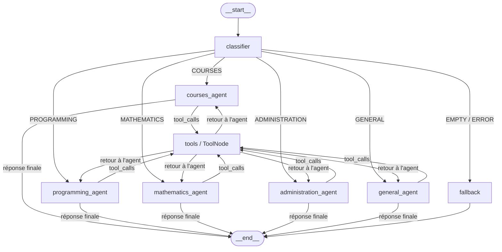

# Rapport de Travaux Pratiques : Conception d'Agents IA avec LangGraph

**Auteur :** Yassir  SAMADI 
**Niveau :** Master / Doctorat (IA Avancée & IA Générative)  
**Sujet :** Construction d'un Assistant Universitaire Multi-Agents avec Routage Dynamique, Outils et Mémoire Persistante sous LangGraph  
***Note :***
Ce rapport a été rédigé par moi mème en tenant compte des instructions du laboratoire et des ressources fournies et j'ai bien compris les notions et les conceptes abordés dans ce travail pratique. j'utilise  l'AI pour la correction grammaticale et la mise en forme du rapport . ainsi de trouver pour la répitition de l'execution de quelque  fonctionnalité de projet .

---

## 1. Introduction & Objectifs du Lab

Ce travail pratique porte sur le développement d'architectures d'agents conversationnels et autonomes à base de modèles de langage (LLM). L'objectif est de dépasser le paradigme classique des pipelines séquentiels linéaires (DAGs) pour implémenter des **systèmes cycliques, dynamiques et à états partagés** à l'aide de **LangGraph**.

Le livrable final intègre :
- Un classifieur d'intentions avec gestion défensive des erreurs.
- Des agents experts spécialisés (Cours, Programmation, Mathématiques, Administration, Général).
- L'exécution sécurisée d'outils (calculateur arithmétique sandboxé via AST, horodatage temps réel).
- Une mémoire multi-tours isolée par session (`thread_id`).
- Un rapport réflexif répondant aux questions fondamentales du laboratoire.

---

## 2. Réponses aux Questions Conceptuelles

### 2.1. Partie I — Écosystème et Fondations (Cellule 5)

#### Q1 : Quel est le rôle de LangChain ?
**LangChain** est une bibliothèque d'orchestration fournissant des abstractions modulaires pour composer des applications autour des LLMs. Son rôle principal est d'agir comme une boîte à outils standardisée :
- **Connecteurs de modèles :** Interfaces unifiées pour les LLMs propriétaires ou locaux (`ChatOpenAI`, `ChatAnthropic`, `ChatOllama`).
- **Gestion des interactions :** Templates de prompts (`PromptTemplate`), parseurs de sortie (*output parsers*), interfaces pour les outils (`@tool`).
- **Composition linéaire (LCEL) :** Chaînage d'opérations déclaratif (`prompt | model | parser`).

*En résumé :* LangChain fournit les composants élémentaires (briques Lego) pour interagir avec les modèles.

#### Q2 : Quel est le rôle de LangGraph ?
**LangGraph** est une extension de LangChain dédiée à la création de **workflows cycliques et à états (*stateful*)** représentés sous forme de graphes orientés. Alors que les chaînes classiques interdisent ou gèrent mal les boucles, LangGraph permet :
- **Les cycles de rétroaction (*feedback loops*) :** Un agent peut décider d'appeler un outil, recevoir l'observation, ré-analyser l'état et réitérer jusqu'à convergence.
- **La gestion centralisée de l'état (*State*) :** Un objet partagé et typé qui évolue à chaque passage dans un nœud.
- **La persistance et reprise (*Checkpointers*) :** Sauvegarde automatique de l'historique dans des backends (mémoire, SQLite, Redis) pour gérer la mémoire conversationnelle et le *time-travel debugging*.
- **Le contrôle d'exécution :** Branchements conditionnels dynamiques et intervention humaine (*human-in-the-loop*).

#### Q3 : Quel est le rôle d'un LLM ?
Le **LLM (Large Language Model)** est le moteur d'inférence probabiliste et de raisonnement sémantique (le "cerveau"). Il :
- Interprète les requêtes humaines en langage naturel.
- Synthétise des informations et produit du texte cohérent.
- Détermine la logique d'appel de fonctions (*function / tool calling*).

*Limitation clé :* Un LLM pur est **strictement sans état (*stateless*)**. Il ne mémorise rien d'un appel à l'autre et ne peut interagir avec le monde extérieur (fichiers, calculs stricts, bases de données) sans un orchestrateur comme LangGraph.

---

### 2.2. Partie II — Primitives de LangGraph (Cellule 11)

#### Q1 : Qu'est-ce qu'un nœud (*Node*) ?
Un **nœud** représente une unité d'exécution autonome dans le graphe. Concrètement en Python, il s'agit d'une fonction (ou d'un Runnable) qui reçoit l'état courant (`state`), effectue une opération (appel LLM, calcul, requête API) et retourne un dictionnaire contenant les **mises à jour à appliquer à l'état**.

#### Q2 : Qu'est-ce qu'une arête (*Edge*) ?
Une **arête** relie un nœud source à un ou plusieurs nœuds de destination, guidant le flux d'exécution :
- **Arête statique (`add_edge(A, B)`) :** Après l'exécution de $A$, le contrôle passe systématiquement à $B$.
- **Arête conditionnelle (`add_conditional_edges(A, routing_fn, path_map)`) :** Une fonction Python inspecte l'état courant et retourne dynamiquement le nom du nœud suivant à exécuter.

#### Q3 : Qu'est-ce que `START` ?
`START` est le pseudo-nœud d'entrée virtuel du graphe. Dès que `graph.invoke(input_data)` est déclenché, `START` initialise l'état avec la charge utile reçue et achemine immédiatement le flux vers le premier nœud de traitement.

#### Q4 : Qu'est-ce que `END` ?
`END` est le pseudo-nœud de sortie et de terminaison. Dès qu'une transition pointe vers `END`, le graphe arrête son exécution et renvoie l'état final à l'utilisateur.

#### Q5 : Pourquoi l'état (*State*) est-il transmis entre les nœuds ?
Dans un agent autonome, chaque étape a besoin du contexte généré par les étapes précédentes (la question d'origine, le prompt système, l'historique de conversation, la catégorie identifiée, les résultats bruts des outils).  
L'état partagé applique le patron de conception du **tableau noir (*Blackboard Pattern*)** : au lieu de chaîner maladroitement des arguments de fonction en cascade, tous les nœuds lisent et enrichissent une structure unique, typée et centralisée.

---

### 2.3. Partie VI — Discussion sur l'Évaluation du Routeur (Cellule 46)

#### Analyse des défaillances potentielles d'un routeur naïf :
Dans une implémentation basée sur une simple invite textuelle :
1. **Sensibilité au formatage libre :** Le LLM peut répondre par une phrase polie (ex: *"The best category for this is mathematics."*) plutôt que par le seul identifiant `"mathematics"`. Les vérifications par sous-chaînes ou expressions régulières restent vulnérables.
2. **Ambiguïté interdisciplinaire :** Une question telle que *"Comment calculer la descente de gradient en Python ?"* contient à la fois des concepts mathématiques et du code informatique. Sans critères de départage précis, le modèle oscille aléatoirement d'une exécution à l'autre.
3. **Dérive de vocabulaire (Hallucinations) :** Le modèle peut inventer une étiquette absente du dictionnaire de routage (ex: `"calculus"`, `"coding"`, `"general"`), provoquant une exception ou une chute non contrôlée dans une branche par défaut.

#### Solutions pour fiabiliser le routage :
1. **Sorties Structurées (*Structured Outputs* / Schémas Pydantic) :**  
   L'utilisation de `.with_structured_output(CategoryEnum)` contraint l'échantillonnage de tokens du LLM au schéma JSON strict d'une énumération Python. Le résultat est garanti conforme à 100%.
2. **Few-Shot Prompting :**  
   Fournir dans le prompt système 2 à 3 exemples ciblés pour chaque catégorie, en insistant particulièrement sur les cas limites (par exemple : déclarer que tout problème demandant du code exécutable relève de `PROGRAMMING`).
3. **Validation défensive et Fallback explicite :**  
   Intercepter programmatiquement toute sortie inconnue ou chaîne vide avant la décision de branchement, avec redirection vers un agent généraliste ou un message de clarification.
4. **Température nulle (`temperature = 0.0`) :**  
   Supprimer la stochasticité pour assurer un comportement déterministe et reproductible.

---

## 3. Architecture du Projet Capstone : Assistant Universitaire

### 3.1. Schéma du Graphe

### 3.2. Principes Clés d'Implémentation

1. **Gestion d'État par Réducteur (`add_messages`) :**  
   Le `messages: Annotated[list, add_messages]` concatène intelligemment les nouveaux messages sans écraser l'historique complet, préservant la chronologie utilisateur $\leftrightarrow$ agent $\leftrightarrow$ outil.
2. **Sécurité contre les Injections de Code :**  
   Au lieu d'utiliser la fonction native vulnérable `eval()`, l'outil `calculator` repose sur un analyseur syntaxique abstrait (**AST** - *Abstract Syntax Tree*). Seuls les nœuds arithmétiques stricts sont autorisés, bloquant toute tentative d'exécution de code malveillant.
3. **Boucle Outils en Étoile Réentrante :**  
   Lorsqu'un agent spécialisé (ex: `mathematics_agent`) émet un appel d'outil, le contrôle est transféré au nœud `tools`. Dès l'évaluation terminée, le retour s'effectue dynamiquement vers ce même agent spécialisé afin qu'il formule la réponse finale à l'étudiant.
4. **Mémoire Multi-Sessions avec `thread_id` :**  
   Grâce au `MemorySaver`, chaque fil de discussion dispose de son propre état persistant. Deux sessions distinctes (`ahmed-1` vs `other-thread`) conservent une étanchéité totale de leurs historiques.
5. **Résilience et Tolérance aux Pannes :**  
   - Les requêtes vides sont interceptées en amont et orientées vers le nœud `fallback`.
   - Les erreurs d'API LLM sont capturées dans des blocs `try/except` avec messages de relance pédagogiques.
   - Les exceptions générées par les outils sont converties en messages de retour via `ToolNode(..., handle_tool_errors=True)`.

---

## 4. Synthèse des Livrables Produits

| Livrable | Emplacement | Description |
|---|---|---|
| **Notebook Exécuté** | `langgraph_lab.ipynb` | Notebook complet avec toutes les réponses insérées et sorties de cellules générées |
| **Code Source Modulaire** | `src/` & `main.py` | Architecture Python modulaire (`state.py`, `tools.py`, `agents.py`, `graph.py`) |
| **Diagramme d'Architecture** | `architecture.mmd` | Diagramme Mermaid complet du workflow |
| **Captures d'Écran** | `screenshots/` | 6 captures d'écran haute résolution illustrant chaque phase de l'exécution |
| **Guide d'Utilisation** | `README.md` | Guide de démarrage, installation, exécution et choix de conception |
| **Dépendances** | `requirements.txt` | Spécification des versions requises |

---
*Fin du rapport.*

